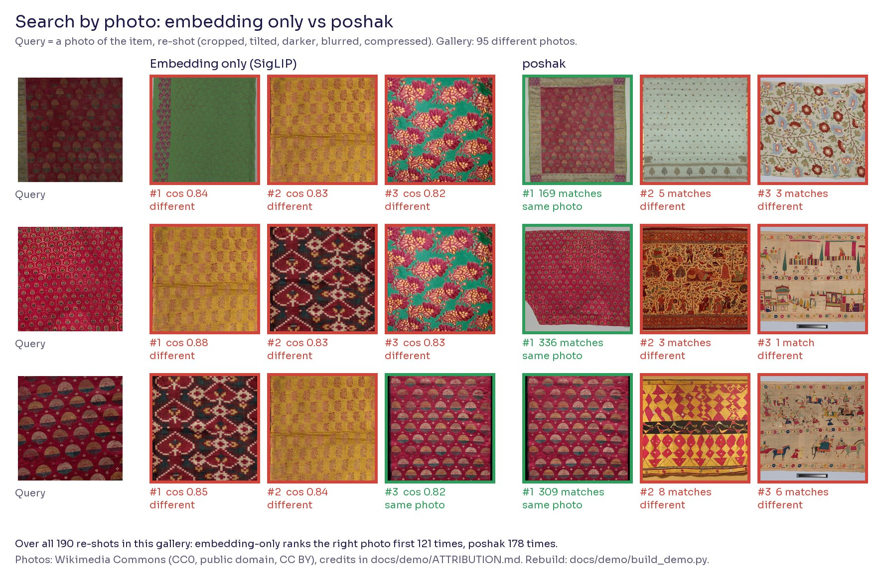
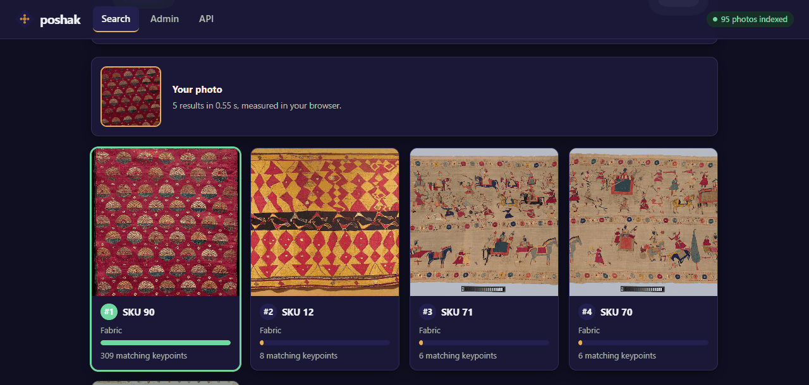
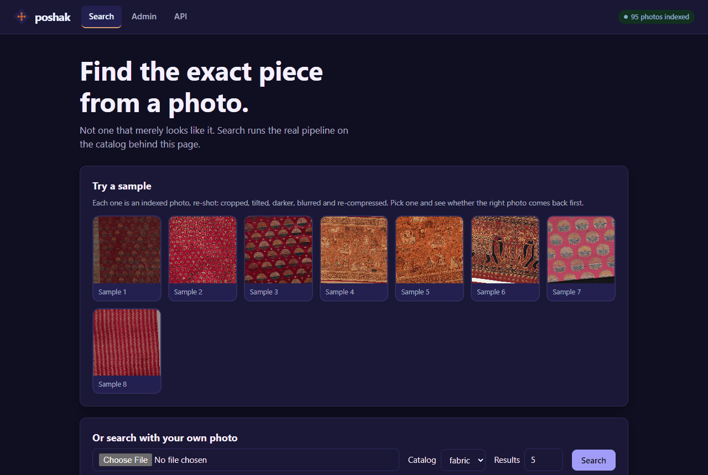
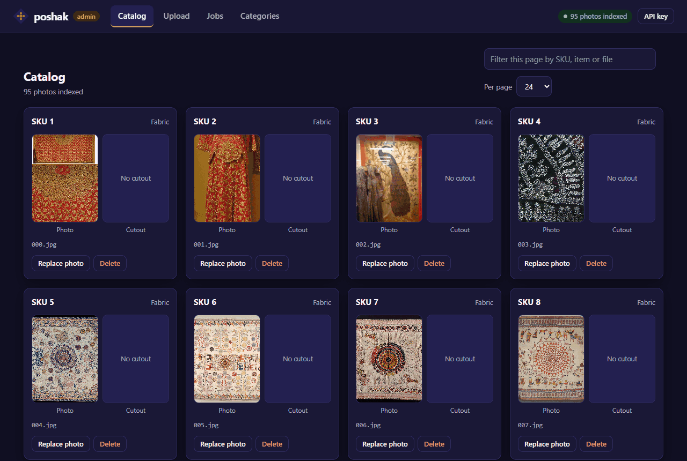
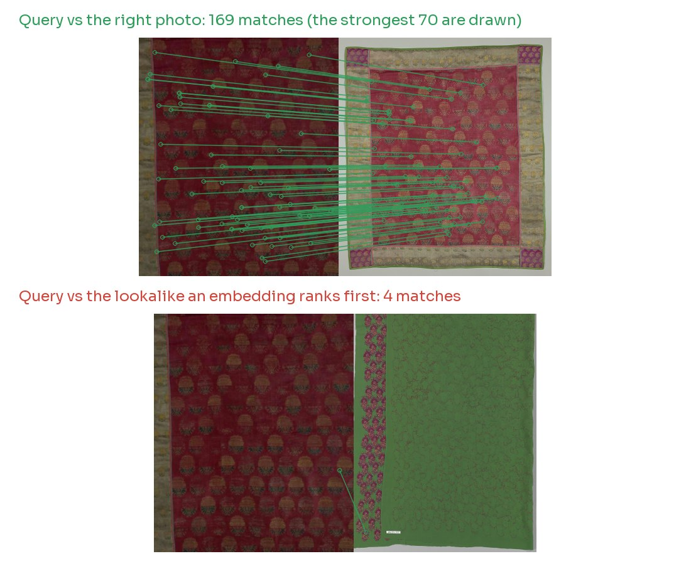

<div align="center">

<picture>
  <source media="(prefers-color-scheme: dark)" srcset="docs/assets/brand/banner-dark.svg">
  
</picture>

<h3>Embeddings find lookalikes. poshak finds the exact garment.</h3>

Two-stage visual search for Indian wear · SigLIP recall + SIFT verification · built to run on a 2 GB CPU box

[](https://github.com/vivekkushalch/poshak/actions/workflows/ci.yml)
[](LICENSE)
[](pyproject.toml)
[](https://github.com/astral-sh/ruff)
[](https://github.com/astral-sh/uv)

[Quickstart](#quickstart) · [How it works](#how-it-works) · [Benchmarks](#benchmarks) · [Architecture](docs/architecture.md) · [API](#api) · [Deploy](docs/deployment.md)

</div>

<br>

<picture>
  <source media="(prefers-color-scheme: dark)" srcset="docs/assets/pipeline-dark.svg">
  
</picture>

Upload a photo of a sherwani, an indowestern or a fabric swatch. poshak returns the
catalog SKUs it matches, ranked by how many local features line up.

Image embeddings like CLIP and SigLIP are good at "a long embroidered jacket".
They are bad at "*that* long embroidered jacket". In an Indian wear catalog,
hundreds of pieces share a cut and a colour and differ only in their zari,
butis and borders. poshak uses an embedding to shortlist and SIFT to decide.

## See it work



This is real output, not a mock-up. Each row is one search: the query on the left, what an
embedding-only search returns in the middle (red: a different photo), what poshak returns on the
right (green: the right photo, with its match count).

| Right photo ranked first | Embedding only | poshak |
|---|---|---|
| All 190 re-shots | 121 (64%) | **178 (94%)** |
| Mild re-shots (95) | 73 | **93** |
| Heavy re-shots (95) | 48 | **85** |

- The gallery is 95 photographs of Indian textiles and garments from Wikimedia Commons (CC0,
  public domain or CC BY, [credits](docs/demo/ATTRIBUTION.md)), with whole families of
  near-identical pieces.
- A query is a re-shot of one gallery photo: cropped, tilted, darker, blurred and re-compressed.
  That is easier than a second photograph of the same object; the [benchmarks](#benchmarks) below
  include that harder case.
- poshak ran with `RANKER=v2`. Its settings were fixed on a different, private catalog before this
  gallery existed. Nothing was tuned on these photos.
- Rebuild it all with `uv run python docs/demo/build_demo.py --out docs/assets/demo`. It downloads
  the photos, runs the real SigLIP model and redraws both figures.

### The app

The service ships with a search page at `/ui` and an admin at `/admin`. These are real
screenshots of the demo gallery.



| Search page | Admin catalog |
|---|---|
|  |  |

## Highlights

- **Two-stage retrieval.** SigLIP cosine recalls 40 candidates. Lowe-ratio SIFT
  matching ranks them. Query cost is set by those 40, not by catalog size.
- **Dual-view matching for garments.** Each search runs on the photo and on a
  background-removed cutout, then fuses per SKU, so a busy backdrop can't hide a match.
- **Small-box friendly.** Built for a 2 GB VM: descriptors are precomputed at
  ingest, images are processed at 768 px, concurrent searches are capped.
- **Drop-in backends.** Storage, embedder, background removal and the vector index
  sit behind `Protocol` ports. Local disk and S3 (or MinIO, R2) ship today.
- **Production basics.** Async ingest with a resumable job queue, typed Pydantic
  API with OpenAPI docs, liveness and readiness probes, settings validated at boot.
- **Refactor-proof ranking.** A golden test pins ranked results from the original
  implementation at the engine, service and HTTP layers.

## Quickstart

```bash
git clone https://github.com/vivekkushalch/poshak && cd poshak
docker compose up -d --build
curl localhost:8088/health
```

Index a few photos, then search with a new shot of one of them:

```bash
curl -F image=@swatch.jpg -F photo_name=fabric_202_1.jpg -F sku_id=202 \
     -F designno=FB-202 -F item=Fabric localhost:8088/ingest
curl -F image=@query.jpg -F category=fabric -F top_k=3 localhost:8088/search
```

<details>
<summary>Example response (real output, trimmed to two results)</summary>

```json
{
  "status": "success",
  "method": "SIFT",
  "category": "fabric",
  "total_found": 3,
  "model_tag": "siglip-base-patch16-224-v2-768",
  "results": [
    {
      "sku_id": 202,
      "unified_score": 1.0495180487632751,
      "total_sift_matches": 379,
      "tier": "HIGH",
      "best_entry": {
        "sku_id": 202,
        "designno": "FB-202",
        "item": "Fabric",
        "filename": "fabric_202_1.jpg",
        "json_filename": "fabric_202_1.jpg"
      }
    },
    {
      "sku_id": 203,
      "unified_score": 1.0492178201675415,
      "total_sift_matches": 110,
      "tier": "HIGH",
      "best_entry": {
        "sku_id": 203,
        "designno": "FB-203",
        "item": "Fabric",
        "filename": "fabric_203_1.jpg",
        "json_filename": "fabric_203_1.jpg"
      }
    }
  ]
}
```

The query was a re-cropped, re-compressed photo of SKU 202. Ranking is by
`total_sift_matches` first: 379 against 110 for the runner-up, even though the
confidence scores are close.

</details>

Without Docker, using [uv](https://docs.astral.sh/uv/):

```bash
uv sync
DISABLE_AUTH=1 DATA_ROOT=./.localdata CORPUS_DIR=./.localcorpus/uploads \
  RMBG_DIR=./.localcorpus/rmbg uv run poshak serve
```

Then open `/ui` for a phone-friendly search page, `/admin` to upload photos, watch
indexing jobs, browse the catalog and fix cutouts, or `/docs` for the OpenAPI reference.

To index a catalog that is already in storage:

```bash
uv run poshak seed --json catalog.json   # resumable; --force re-indexes
```

## How it works

| Stage | What happens | Cost |
|---|---|---|
| Ingest | Photo is stored, background removed (cloth), resized to 768 px, embedded with SigLIP, SIFT descriptors computed and stored | Once per photo |
| Recall | Query embedding against every indexed view, top 40 by cosine | Grows with catalog size, one matrix product |
| Verify | Query SIFT keypoints matched to each candidate's stored descriptors with Lowe's 0.75 ratio test | Fixed: 40 candidates, run on a thread pool |
| Score | Good-match count sets a confidence tier, cosine adds a small tiebreak | |
| Fuse (cloth) | Cutout pass and original pass merged per SKU; SKUs found by both rank higher | |

Results sort by total SIFT matches, then by the fused score. The constants were
tuned together on the original catalog; [ADR 0001](docs/adr/0001-sift-verification.md)
explains why ranking works this way.



The right photo shares hundreds of local keypoints with the query. The lookalike an embedding
prefers shares almost none. The counts are the search's own; the lines are redrawn at a smaller
size, so a few matches in the count may not show as lines.

## Benchmarks

Measured with the real models on a 2017 laptop CPU (Intel i5-7200U, 2 cores and 4
threads, no GPU), 1600×1200 photos.

<picture>
  <source media="(prefers-color-scheme: dark)" srcset="docs/assets/bench-stages-dark.svg">
  
</picture>

<picture>
  <source media="(prefers-color-scheme: dark)" srcset="docs/assets/bench-scaling-dark.svg">
  
</picture>

| | p50 | p95 |
|---|---|---|
| Cloth search, end to end | 4.89 s | 5.13 s |
| Fabric search, end to end | 1.39 s | 1.50 s |
| Index one cloth photo (cutout, 2 embeddings, 2 descriptor sets) | 5.22 s | |
| Index one fabric photo | 0.97 s | |
| Recall top 40 of 100k / 1M photos | 22 ms / 384 ms | 25 ms / 771 ms |
| Verify 40 candidates, sequential / 4 threads | 530 ms / 412 ms | 542 ms / 418 ms |

What the numbers say:

- Background removal on the query is 56% of a cloth search. It is the first thing
  to move to a GPU or a smaller segmentation model.
- Recall is negligible up to 100k photos. At a million it matches the verification
  cost on this CPU, which is the point to switch the `VectorIndex` to ANN.
- Threaded verification gains 1.3× on two physical cores, and should scale with
  cores on server hardware.

These are latency numbers on synthetic images. Retrieval accuracy needs a labelled
dataset and is the next milestone on the [roadmap](#roadmap). Reproduce with:

```bash
uv run python bench/latency.py && uv run python bench/charts.py
```

### Faster and more accurate on small catalogs: `RANKER=v2`

For catalogs of up to about a thousand photos, the opt-in v2 ranker replaces the
second background-removal pass with a cheap whole-catalog SIFT pass, counts only mutual
matches, and stops as soon as the leading SKU is clear. The embedding is computed only
when the cheap stages cannot decide. Enable it with `RANKER=v2` and run
`poshak refresh-descriptors` once ([ADR 0006](docs/adr/0006-progressive-ranking.md)).

Accuracy is recall@1 on held-out test queries that were never used to choose a setting.
"Re-shots" are indexed photos degraded to look like a customer's phone photo (crop, tilt,
exposure, blur, heavy JPEG).

| Query | n | Legacy | v2 |
|---|---|---|---|
| **Real shop catalog** (408 SKUs, 12 MP phone photos) | | | |
| Cloth, mild re-shot | 100 | 96% | **98%** |
| Cloth, heavy re-shot | 100 | 89% | **93%** |
| Fabric, both levels | 50 | 92% | **96%** |
| A different photo of the same SKU | 99 | 30% | **37%** |
| **DeepFashion In-shop sample** (224 px studio photos) | | | |
| Mild re-shot | 37 | 95% | **100%** |
| Heavy re-shot | 37 | 38% | **65%** |
| A different view of the same item | 73 | 52% | **78%** |

Search time through the real services on the same laptop CPU (i5-7200U, no GPU), measured on
only 3 queries per group, so read it as a ballpark:

| Search | Legacy | v2 |
|---|---|---|
| Cloth | 5.3 to 5.6 s | **0.7 s** |
| Fabric | 1.5 to 1.7 s | **0.5 s** |

Limits worth knowing: the re-shots are simulated, so real customer photos will score lower;
the catalog is one shop and mostly sherwanis; and on DeepFashion cross-view photos the
embedding alone (95%) still beats both rankers, so v2's blend of embedding and geometry is a
compromise between the two kinds of data. Reproduce with `bench/lab.py` (accuracy) and
`bench/compare_rankers.py` (timing).

## Architecture

<picture>
  <source media="(prefers-color-scheme: dark)" srcset="docs/assets/arch/components-dark.svg">
  
</picture>

Ports and adapters around a pure engine. `container.py` is the one place that picks
implementations, so adding a backend is a new class and one line of wiring. A test
enforces the layer rules on every CI run.
The [architecture document](docs/architecture.md) covers system context,
containers, request and ingest sequences, the data model, ranking formulas, the
latency and memory budgets, failure modes, security and the scaling path.
Decisions and their trade-offs are recorded as [ADRs](docs/adr).

<details>
<summary>Project layout</summary>

```
src/poshak/
├── api/              routes and Pydantic schemas
├── services/         search, indexer, jobs, catalog, live index state
├── engine/           recall, SIFT verification, scoring, fusion (no I/O)
├── domain/           models, Protocol ports, errors
├── infrastructure/
│   ├── storage/      local disk, S3
│   ├── background/   U2Net, HTTP, fallback chain
│   ├── embedding/    SigLIP
│   ├── vector/       numpy exact search
│   └── db/           SQLite repositories + migrations
├── core/             settings, logging, API-key check
├── container.py      composition root
├── main.py           create_app()
└── cli.py            poshak serve | seed
```

</details>

## API

| Method | Path | Purpose |
|---|---|---|
| `POST` | `/search` | Rank SKUs for a query photo (`category`: `cloth` or `fabric`) |
| `POST` | `/ingest` | Store a photo and queue it for indexing; returns `202` and a `batch_id` |
| `GET` | `/index/jobs/{batch_id}` | Batch progress and per-photo errors |
| `POST` | `/replace` | Swap a photo or its cutout and re-index |
| `POST` | `/forget` | Delete a photo, its cutout, descriptors and index row |
| `GET` | `/skus` | Page through indexed photos |
| `GET` `POST` | `/categories` | Inspect or override which pipeline an item type uses |
| `GET` | `/img/original/{name}` · `/img/rmbg/{name}` | Serve stored images |
| `GET` | `/health` · `/health/live` · `/health/ready` | Status and probes |

Data routes require an `X-API-Key` header. Full schemas at `/docs`.

<details>
<summary>Configuration</summary>

Settings come from environment variables and are validated at startup, so a bad
combination such as `STORAGE_BACKEND=s3` without `S3_BUCKET` fails before the
first request.

| Variable | Default | Notes |
|---|---|---|
| `API_KEY` | | Required unless `DISABLE_AUTH=1` |
| `STORAGE_BACKEND` | `local` | `local` or `s3` |
| `S3_BUCKET` · `S3_REGION` · `S3_ENDPOINT_URL` | | Endpoint URL for MinIO or R2 |
| `DATA_ROOT` | `/data` | SQLite index and descriptors |
| `CORPUS_DIR` · `RMBG_DIR` | `/corpus/uploads` · `/corpus/rmbg` | Local photo storage |
| `EMBED_MODEL_ID` | `google/siglip-base-patch16-224` | Changing it starts a new index tag |
| `REMBG_API_URL` | | Optional remote background removal at index time |
| `MAX_CONCURRENT_SEARCHES` | `2` | Extra searches wait 10 s, then get `503` |
| `SIFT_WORKERS` | `4` | Threads for candidate verification |
| `RANKER` | `legacy` | `v2` is the faster, more accurate ranker for small catalogs (see above) |
| `V2_MAX_VIEWS` | `1000` | v2 serves a category only up to this many photos, then legacy takes over |
| `LOG_LEVEL` | `INFO` | `DEBUG` logs per-stage timings |

Everything else is in [.env.example](.env.example).

</details>

## Development

```bash
uv sync
uv run pytest -m "not slow"    # the whole suite, about a minute, no model downloads
uv run ruff check && uv run ruff format --check
```

Tests run the real container with in-memory fakes for the models and storage, so
they cover the same wiring as production. Storage backends share one contract
suite, and S3 runs against [moto](https://github.com/getmoto/moto). See
[CONTRIBUTING.md](CONTRIBUTING.md) before changing anything that affects ranking.

## Roadmap

- [x] Two-stage retrieval with dual-view fusion
- [x] Pluggable storage with S3 support
- [x] Async, resumable ingest
- [x] Accuracy evaluation with a held-out test split (DeepFashion sample and one real catalog)
- [x] Opt-in v2 ranker for small catalogs
- [ ] A public Indian-wear retrieval benchmark (none exists with item identities)
- [ ] Skip background removal at index time for v2-only deployments (about half the indexing time)
- [ ] v2 beyond a thousand photos (an indexed coarse stage instead of a full scan)
- [ ] ANN vector index for catalogs past a few hundred thousand photos
- [ ] Postgres repositories and a shared queue for multi-node ingest
- [ ] MCP server so agents can search a catalog
- [ ] Learned local features (LightGlue) as an alternative verifier

## Acknowledgements

poshak stands on [SigLIP](https://arxiv.org/abs/2303.15343) (Zhai et al., 2023),
[SIFT](https://www.cs.ubc.ca/~lowe/papers/ijcv04.pdf) (Lowe, 2004),
[U²-Net](https://arxiv.org/abs/2005.09007) through [rembg](https://github.com/danielgatis/rembg),
[OpenCV](https://opencv.org), [FastAPI](https://fastapi.tiangolo.com) and
[Hugging Face Transformers](https://github.com/huggingface/transformers).

The evaluation uses a sample of the [DeepFashion In-shop](https://mmlab.ie.cuhk.edu.hk/projects/DeepFashion.html)
benchmark (Liu et al., 2016), a research dataset. Only aggregate metrics are published here and
none of its images are redistributed; check its terms before you reuse it.

## Citation

```bibtex
@software{poshak,
  author  = {vivekkushalch},
  title   = {poshak: fine-grained visual search for Indian wear},
  url     = {https://github.com/vivekkushalch/poshak},
  version = {0.3.0},
  year    = {2026}
}
```

## License

Code is [MIT](LICENSE). The logo and brand assets are described in
[docs/brand.md](docs/brand.md); the wordmark uses Sora under the SIL Open Font License.
