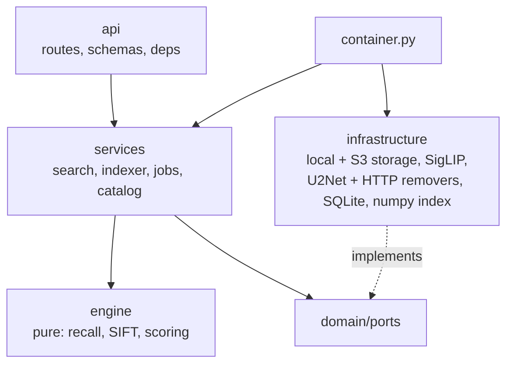

# poshak

[](https://github.com/vivekkushalch/poshak/actions/workflows/ci.yml)
[](LICENSE)


Visual search for Indian wear. Upload a photo of a sherwani, an indowestern or a
fabric swatch, and poshak returns the catalog SKUs that match it.

SigLIP sees the silhouette. SIFT sees the zari.

## Why two models

Image embeddings like CLIP and SigLIP are good at "this is a long embroidered
jacket". They are bad at "this is *that* long embroidered jacket". Two sherwanis
with the same cut and colour land next to each other in embedding space even when
their embroidery is completely different, and in this catalog the embroidery is
the product.

So poshak uses the embedding only to shortlist, and lets local features decide:


SIFT good-match count is the primary ranking signal. Cosine similarity only breaks
ties. For garments, the search runs twice, once on the original photo and once on
a background-removed cutout, and fuses the two per SKU. A SKU that matches in both
views ranks above one that matches in only one.

Verification always runs on 40 candidates, whatever the catalog size. Only the
recall step grows with N, and it is a single matrix product today that an ANN
index can replace later.

## Quickstart

With Docker:

```bash
docker compose up -d --build
curl localhost:8088/health
```

Without Docker, using [uv](https://docs.astral.sh/uv/):

```bash
uv sync
DISABLE_AUTH=1 DATA_ROOT=./.localdata CORPUS_DIR=./.localcorpus/uploads RMBG_DIR=./.localcorpus/rmbg uv run poshak serve
```

Add a photo and search for it:

```bash
curl -F image=@sherwani.jpg -F sku_id=42 -F item=Sherwani -F photo_name=sherwani.jpg localhost:8088/ingest
curl -F image=@query.jpg -F category=cloth localhost:8088/search
```

`/ui` is a small search page that works from a phone camera. `/admin` lists indexed
photos next to their cutouts and lets you replace either. The OpenAPI docs are at
`/docs`.

To index a whole catalog whose photos are already in storage:

```bash
uv run poshak seed --json catalog.json
```

`catalog.json` is `{"skus": [{"sku_id": 1, "designno": "D1", "item": "Sherwani", "images": ["1_a.jpg"]}]}`.
Seeding is resumable. Photos that are already indexed are skipped unless you pass
`--force`.

## API

| Method | Path | What it does |
|---|---|---|
| POST | `/search` | Rank SKUs for a query photo. `category` is `cloth` or `fabric` |
| POST | `/ingest` | Store a photo and queue it for indexing. Returns 202 and a `batch_id` |
| GET | `/index/jobs/{batch_id}` | Progress and per-photo errors for a batch |
| POST | `/replace` | Swap a photo or its cutout and re-index it |
| POST | `/forget` | Remove a photo, its cutout, descriptors and index row |
| GET | `/skus` | Page through indexed photos |
| GET, POST | `/categories` | See or override which pipeline an item type uses |
| GET | `/img/original/{name}`, `/img/rmbg/{name}` | Serve stored photos |
| GET | `/health`, `/health/live`, `/health/ready` | Status, liveness, readiness |

Every route except health, images and the HTML pages needs an `X-API-Key` header.

## Architecture

Ports and adapters. The search algorithm is a set of pure functions. Everything
that touches a disk, a network or a model sits behind a small interface, so
storage, the embedder, background removal and the vector index can each be
replaced by writing one class.



```
src/poshak/
  api/              routes and Pydantic schemas, nothing else
  services/         use cases: search, indexer, jobs, catalog, index state
  engine/           the algorithm, no I/O
  domain/           models, ports (Protocols), errors
  infrastructure/   storage/, background/, embedding/, vector/, db/
  core/             settings, logging, API key check
  container.py      builds everything from settings
  main.py           create_app()
  cli.py            poshak serve | seed
```

[docs/architecture.md](docs/architecture.md) covers the request flows, the
concurrency model and how the index stays consistent while it reloads. The
reasoning behind the main choices is in [docs/adr](docs/adr).

## Running on a small box

The default deployment is one container on a 2 GB VM. Several choices exist only
to stay under that limit:

- Images are processed at 768 px height. Background removal runs on the full-size
  image for a better mask, then the cutout is downscaled.
- SIFT descriptors are computed once at ingest and stored, so a search never
  decodes candidate images.
- The two cloth pipelines run one after the other, with verification inside each
  spread over a thread pool.
- At most `MAX_CONCURRENT_SEARCHES` searches run at once. Extra requests wait up
  to 10 seconds, then get a 503 with `Retry-After`.

For more than one node, set `STORAGE_BACKEND=s3` so photos and descriptors live in
a bucket. [docs/deployment.md](docs/deployment.md) has both setups.

## Configuration

All settings come from environment variables and are validated at startup. A bad
combination, such as `STORAGE_BACKEND=s3` without `S3_BUCKET`, stops the process
with a clear error instead of failing on the first request.

| Variable | Default | Notes |
|---|---|---|
| `API_KEY` | | Required unless `DISABLE_AUTH=1` |
| `STORAGE_BACKEND` | `local` | `local` or `s3` |
| `S3_BUCKET`, `S3_REGION`, `S3_ENDPOINT_URL` | | Endpoint URL for MinIO or R2 |
| `DATA_ROOT` | `/data` | SQLite index and descriptors |
| `CORPUS_DIR`, `RMBG_DIR` | `/corpus/uploads`, `/corpus/rmbg` | Local photo storage |
| `EMBED_MODEL_ID` | `google/siglip-base-patch16-224` | Changing it changes the index tag |
| `REMBG_API_URL` | | Optional remote background removal for indexing |
| `MAX_CONCURRENT_SEARCHES` | `2` | |
| `SIFT_WORKERS` | `4` | Threads for candidate verification |
| `LOG_LEVEL` | `INFO` | `DEBUG` logs per-stage timings |

The full list is in [.env.example](.env.example).

## Development

```bash
uv sync
uv run pytest -m "not slow"      # ~1 min, no model downloads
uv run ruff check && uv run ruff format --check
```

The tests include a golden file of ranked results for a synthetic catalog. It was
recorded from the original implementation before the code was restructured, and
the engine, the services and the HTTP layer are each checked against it. If a
change moves a ranking, that test fails.

## Roadmap

- A benchmark on a public fashion dataset: recall@k, MRR, latency and memory, with
  an ablation of embedding-only against embedding plus SIFT.
- An ANN vector index for catalogs past a few hundred thousand images.
- Postgres and a shared queue for multi-node indexing.
- An MCP server, so an agent can call "find this in stock".

## License

[MIT](LICENSE)
