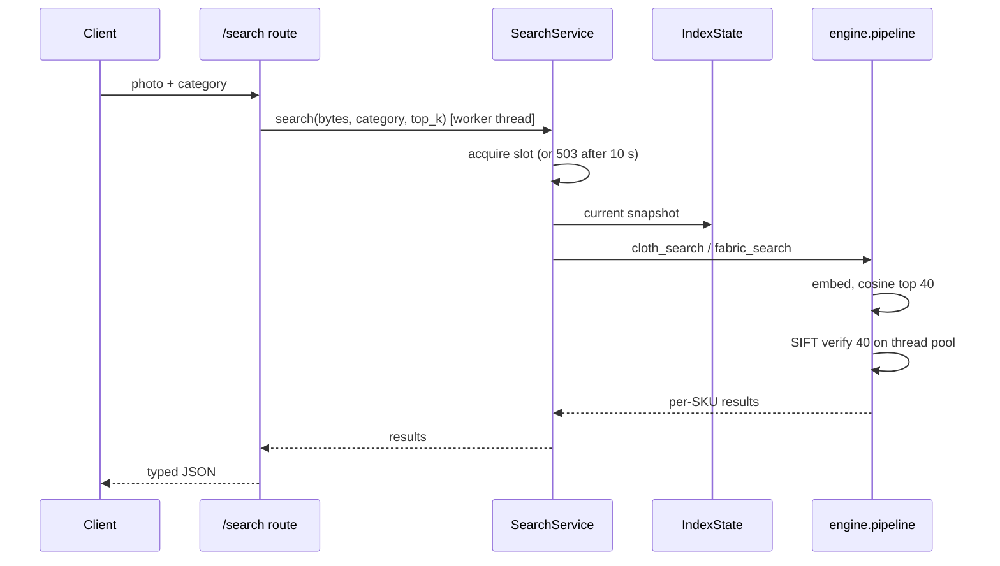
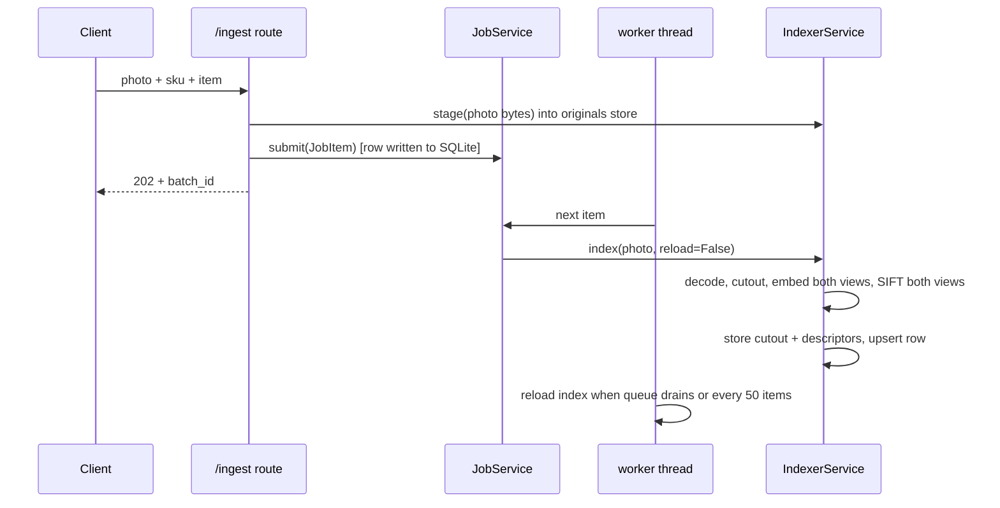

# Architecture

## Layers

| Layer | Path | Depends on | Rule |
|---|---|---|---|
| API | `api/` | services, domain | Parse and validate HTTP, call one service, shape the response |
| Services | `services/` | engine, domain | One class per use case. No HTTP, no concrete infrastructure |
| Engine | `engine/` | domain | Pure functions. Images and vectors in, rankings out |
| Domain | `domain/` | nothing | Dataclasses, `Protocol` ports, error types |
| Infrastructure | `infrastructure/` | domain, engine helpers | Implements the ports |
| Composition root | `container.py` | everything | The only module that names concrete classes |

Services raise domain errors (`NotFound`, `InvalidImage`, `IndexNotReady`,
`Overloaded`). `api/errors.py` maps them to status codes in one place, so no
business code imports FastAPI.

## Ports

| Port | Implementations | Selected by |
|---|---|---|
| `BlobStore` | `LocalBlobStore`, `S3BlobStore` | `STORAGE_BACKEND` |
| `Embedder` | `SiglipEmbedder` | `EMBED_MODEL_ID` |
| `BackgroundRemover` | `U2NetRemover`, `HttpRemover`, `FallbackRemover` | `REMBG_API_URL`, `REMBG_DEFAULT_ENGINE` |
| `VectorIndex` | `NumpyIndex` | container |
| `ImageRepository`, `JobRepository`, `CategoryRepository` | SQLite | container |

Three blob namespaces hold the data, each its own `BlobStore`:

| Namespace | Key | Local default | S3 prefix |
|---|---|---|---|
| originals | `<photo>` | `/corpus/uploads` | `uploads/` |
| cutouts | `<stem>.png` | `/corpus/rmbg` | `rmbg/` |
| descriptors | `<photo>.orig.npz`, `<photo>.rmbg.npz` | `/data/descriptors` | `descriptors/` |

Keys are flat names. Both stores reject anything containing `/`, `\` or `..`, and
one contract test suite runs against both.

## Search

The route is a plain `def`, so FastAPI runs it in its thread pool and the event
loop keeps answering health checks during a search.

For `cloth`, the service removes the background from the full-size query with
local U2Net, then runs two passes: cutout query against cutout index, original
against original. Each pass aggregates to one best image per SKU. The fusion score
rewards SKUs found by both passes. Results sort by total SIFT matches, then by the
fused score.

## Ingest

Every job item is a SQLite row with a status. On startup `JobService.resume()`
re-queues anything still `queued` or `running`, so a crash mid-batch loses no work.
Indexing is idempotent per photo: a photo with a stored row and descriptors is
skipped unless `force` is set.

## Keeping the index consistent

`IndexState.reload()` reads every row for the current model tag, builds three new
partitions (cutouts, originals, fabric) with their vector indexes, and then
replaces the snapshot with one assignment. A search reads `state.current` once and
uses that object to the end, so it never sees a half-built index. The descriptor
cache is cleared on reload because a replaced photo keeps its descriptor keys.

Every row carries a `model_tag`. Rows with a different tag are ignored, so changing
the embedding model or the working resolution can never mix vectors from two
models in one search.

## Concurrency

| Mechanism | Protects |
|---|---|
| `BoundedSemaphore(MAX_CONCURRENT_SEARCHES)` | RAM on a small box. Waits 10 s, then 503 |
| Shared `ThreadPoolExecutor(SIFT_WORKERS)` | CPU for verification. cv2 releases the GIL |
| `IndexerService` lock | Writes to one photo's files and row |
| `IndexState` reload lock | Two reloads building at once |
| SQLite WAL mode | Readers during the worker's writes |

## Scaling path

The current design is one process per node, with the index in memory. That is
deliberate for a 2 GB VM. The ports mark where each piece changes when it stops
being enough:

| Limit | Change |
|---|---|
| Brute-force cosine past a few hundred thousand rows | ANN implementation of `VectorIndex` |
| Photos on one disk | `STORAGE_BACKEND=s3` (available now) |
| One ingest worker per node | Redis or SQS behind `JobService.submit` |
| SQLite per node | Postgres implementations of the repositories |
