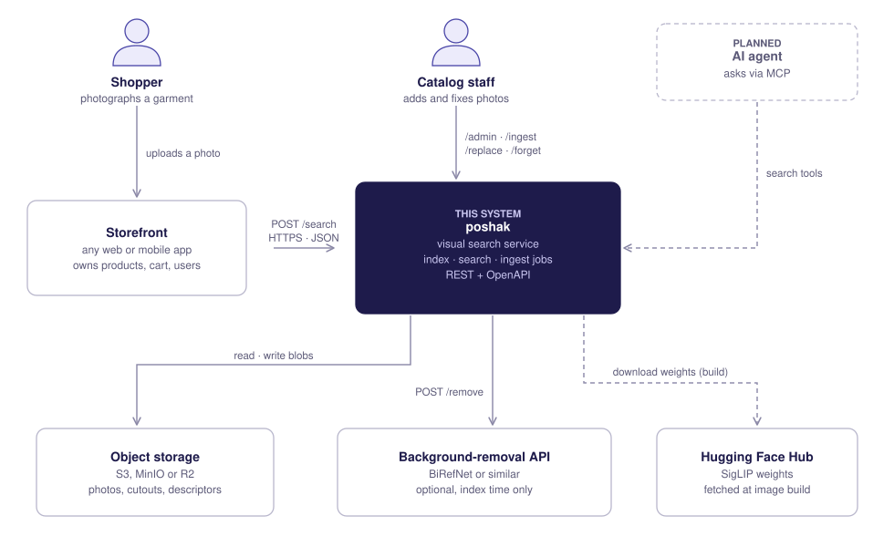
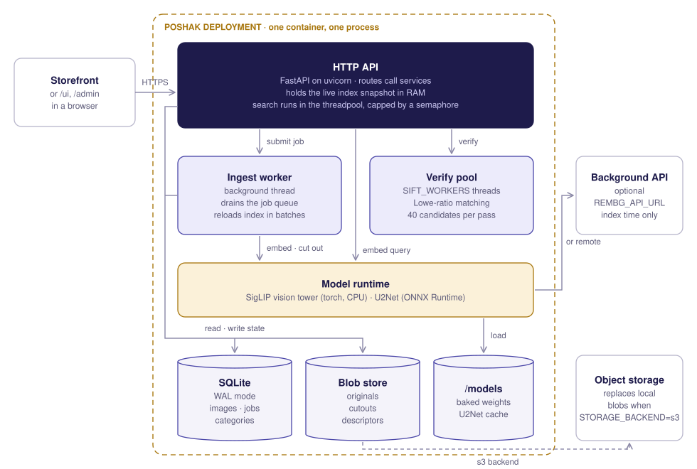
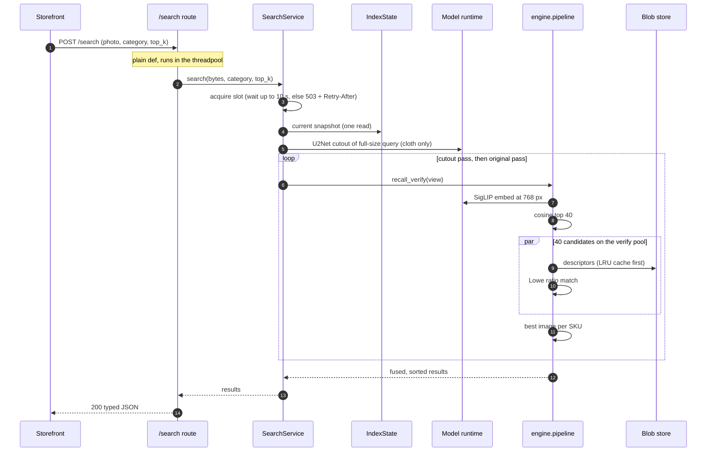
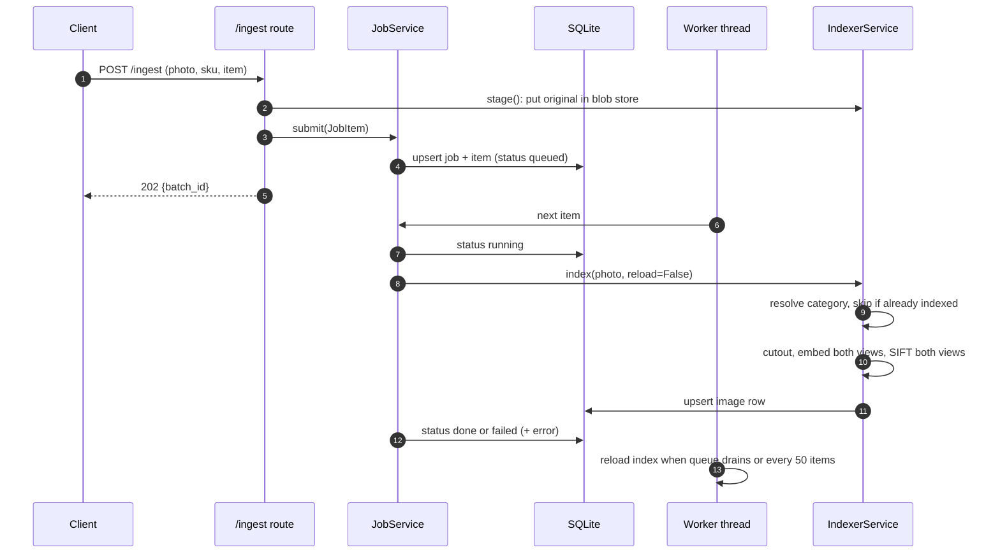
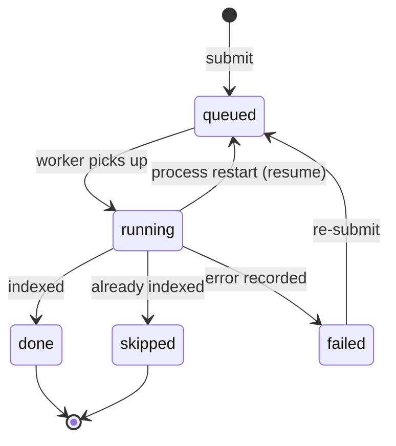
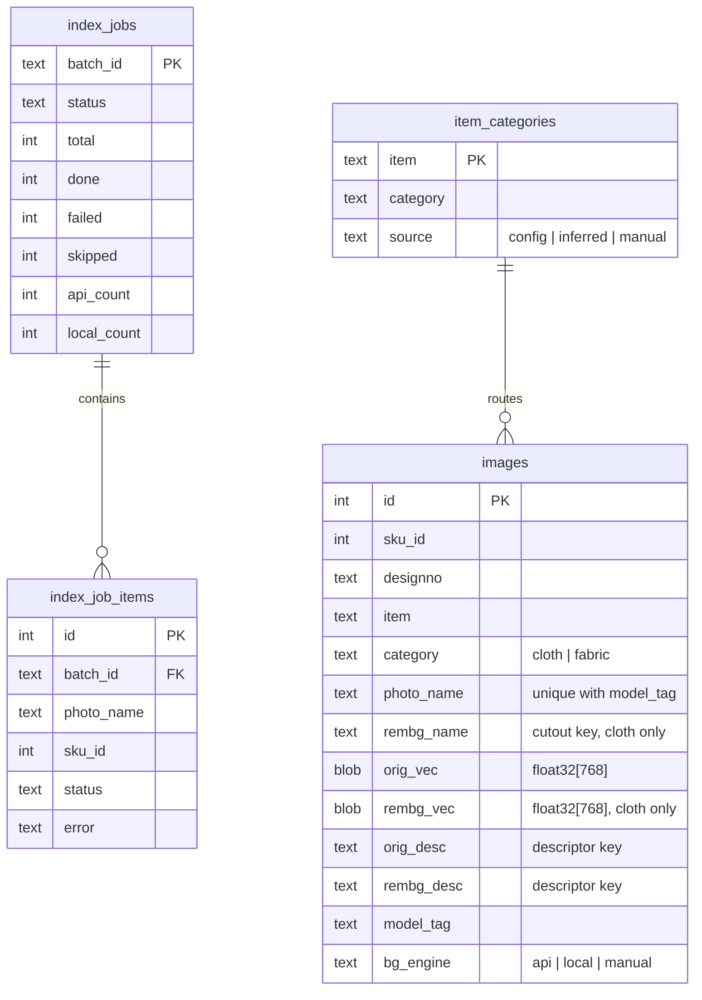

# poshak architecture

| | |
|---|---|
| **Status** | Living document, describes `main` |
| **Version** | 0.3 |
| **Last reviewed** | 2026-10-03 |
| **Audience** | Engineers running, extending or reviewing poshak |

**Contents**
[1. Overview](#1-overview) ·
[2. Requirements](#2-requirements) ·
[3. System context](#3-system-context) ·
[4. Containers](#4-containers) ·
[5. Components](#5-components) ·
[6. Runtime behaviour](#6-runtime-behaviour) ·
[7. Data](#7-data) ·
[8. Ranking](#8-ranking) ·
[9. Quality attributes](#9-quality-attributes) ·
[10. Failure modes](#10-failure-modes-and-recovery) ·
[11. Security](#11-security) ·
[12. Deployment and scaling](#12-deployment-and-scaling) ·
[13. Alternatives considered](#13-alternatives-considered) ·
[14. Risks and open questions](#14-risks-and-open-questions) ·
[15. Glossary](#15-glossary)

## 1. Overview

poshak finds catalog items that match a photo. It is built for catalogs where items
share a silhouette and differ in surface detail: sherwanis, indowesterns,
bandhgalas, printed and woven fabrics.

It runs as a single service next to an existing storefront. The storefront owns
products, prices, users and carts. poshak owns the photos' derived features, the
search index and the ranking. The two meet at a REST API keyed by SKU id.

**In scope:** indexing photos, ranking SKUs for a query photo, keeping the index
consistent as photos are added, replaced and removed.

**Out of scope:** product data, text search, personalisation, user accounts. The
storefront does those.

## 2. Requirements

### Functional

| ID | Requirement |
|---|---|
| F1 | Given a query photo and a category (`cloth` or `fabric`), return the top-k SKUs with per-SKU match evidence |
| F2 | Accept new photos without blocking the caller; report per-photo progress and errors |
| F3 | Replace a photo or its background-removed cutout and re-index it |
| F4 | Remove a photo and everything derived from it |
| F5 | Route each item type to a pipeline, with a manual override |
| F6 | Re-index a full catalog idempotently after a crash or a model change |

### Non-functional

| ID | Attribute | Target | How it is met |
|---|---|---|---|
| N1 | Memory | Fit a 2 GB VM with a few thousand SKUs | 768 px working size, precomputed descriptors, capped concurrency ([9.2](#92-memory)) |
| N2 | Query latency | Interactive on a CPU-only box | Fixed verification cost, threaded verify ([9.1](#91-latency)) |
| N3 | Ranking stability | Refactors never change results | Golden ranking test at three layers |
| N4 | Ingest durability | No accepted photo is lost to a crash | SQLite job checkpoints, resume on start |
| N5 | Consistency | A search never sees a half-updated index | Immutable snapshot, atomic swap |
| N6 | Portability | Storage, model and vector index swappable | Ports and adapters ([5](#5-components)) |
| N7 | Operability | Health probes, fail-fast config | `/health/live`, `/health/ready`, validated settings |

## 3. System context

<picture>
  <source media="(prefers-color-scheme: dark)" srcset="assets/arch/context-dark.svg">
  
</picture>

| Actor or system | Interaction | Protocol and auth | If it is down |
|---|---|---|---|
| Storefront | Sends query photos, displays results | HTTPS, `X-API-Key` | No searches; poshak unaffected |
| Catalog staff | Adds, replaces and removes photos through `/admin` or the API | HTTPS, `X-API-Key` | Catalog changes wait |
| Object storage | Holds photos, cutouts and descriptors when `STORAGE_BACKEND=s3` | AWS SDK, IAM credentials | Searches fail at verification; ingest fails per item and is retried by re-submitting |
| Background-removal API | Cuts out garments at index time | HTTPS, none | Falls back to local U2Net per image |
| Hugging Face Hub | Supplies SigLIP weights | HTTPS at image build only | No effect at runtime |
| AI agents (planned) | Search through an MCP server | MCP | |

## 4. Containers

<picture>
  <source media="(prefers-color-scheme: dark)" srcset="assets/arch/containers-dark.svg">
  
</picture>

| Container | Technology | Responsibility | Scales by |
|---|---|---|---|
| HTTP API | FastAPI, uvicorn (1 worker) | Validates requests, runs searches in the threadpool, owns the in-RAM index snapshot | More replicas behind a load balancer (with S3 storage) |
| Ingest worker | Python thread, `queue.Queue` | Drains the job queue, indexes photos, reloads the index in batches | One per process today; a shared queue in the multi-node design |
| Verify pool | `ThreadPoolExecutor` | SIFT matching of candidates in parallel (OpenCV releases the GIL) | `SIFT_WORKERS` |
| Model runtime | PyTorch (CPU) for SigLIP, ONNX Runtime for U2Net | Embeddings and background removal | CPU cores |
| SQLite | SQLite 3 in WAL mode | Image rows, embeddings, job state, category routing | Postgres repositories (planned) |
| Blob store | Local disk or S3 | Originals, cutouts, SIFT descriptors | Object storage |
| `/models` | Docker volume | Baked SigLIP weights and the U2Net cache | |

The service runs one uvicorn worker on purpose. The index lives in process memory,
so extra workers would each hold a copy and see different reload timing.
Horizontal scale comes from more containers.

## 5. Components

<picture>
  <source media="(prefers-color-scheme: dark)" srcset="assets/arch/components-dark.svg">
  
</picture>

| Module | Responsibility | May import |
|---|---|---|
| `domain/` | Dataclasses, `Protocol` ports, error types | stdlib, numpy |
| `engine/` | Ranking: recall, SIFT, scoring, fusion. Pure functions | `domain` |
| `core/` | Settings, logging, API-key comparison | stdlib, pydantic |
| `services/` | Use cases: search, indexing, jobs, catalog, live index state | `domain`, `engine`, `core` |
| `infrastructure/` | Adapters that implement the ports | `domain`, `engine`, `core`, vendor SDKs |
| `api/` | Routes, request and response schemas, error mapping | `services`, `domain`, `core`, and `container` for dependency injection |
| `container.py` | Builds the object graph from settings | everything |

`tests/unit/test_architecture.py` enforces the "may import" column on every CI run,
so a service that reaches for `boto3` or a domain type that imports FastAPI fails
the build.

### Ports

| Port | Methods | Implementations |
|---|---|---|
| `BlobStore` | `get`, `put`, `delete`, `exists` | `LocalBlobStore` (atomic temp-file rename), `S3BlobStore` |
| `Embedder` | `embed(img) -> float32[d]` | `SiglipEmbedder` (lazy, thread-safe load; text tower dropped) |
| `BackgroundRemover` | `remove(img, engine) -> (cutout, engine)` | `U2NetRemover`, `HttpRemover`, `FallbackRemover` |
| `VectorIndex` | `search(q, k) -> (ids, sims)` | `NumpyIndex` (exact cosine) |
| `ImageRepository`, `JobRepository`, `CategoryRepository` | CRUD for rows | SQLite |

Adding a backend means one class that satisfies the `Protocol`, one branch in
`container.py`, and for storage, passing `tests/integration/test_blobstore_contract.py`.

## 6. Runtime behaviour

### 6.1 Search



The two passes run one after the other to bound peak memory
([ADR 0003](adr/0003-sequential-dual-pipeline.md)). Each pass's verification fans out
over the pool. The pool preserves input order, so ties break the same way as a
sequential loop, and a test checks that both produce identical rankings.

### 6.2 Ingest



### 6.3 Job item states



### 6.4 Startup and recovery

1. Settings load and validate. An invalid combination stops the process here.
2. SQLite opens in WAL mode and migrations run. They are idempotent.
3. Default item-to-pipeline mappings are seeded with insert-or-ignore, so manual
   overrides survive restarts.
4. The index snapshot builds from every row with the current `model_tag`.
5. The worker starts and re-queues every item still `queued` or `running`.
6. `/health/ready` turns 200 once the snapshot has entries.

On shutdown, the worker gets a stop sentinel and finishes its current item, and the
verify pool cancels pending futures.

## 7. Data

### 7.1 Relational model



Embeddings live in SQLite as float32 blobs and are stacked into matrices at reload.
At 768 dimensions that is 3 KB per indexed view.

### 7.2 Blob namespaces

| Namespace | Key | Written by | Read by |
|---|---|---|---|
| originals | `<photo_name>` | `/ingest`, `/replace` | indexer, `/img/original` |
| cutouts | `<stem>.png` | indexer, `/replace kind=rmbg` | indexer, `/img/rmbg` |
| descriptors | `<photo>.orig.npz`, `<photo>.rmbg.npz` | indexer | search (via LRU cache) |

Keys are flat file names. Both stores reject `/`, `\` and `..`.

### 7.3 Versioning

Every row carries `model_tag`, derived from the embedding model id and the working
resolution. The index loads only matching rows, so a model change never mixes
embedding spaces ([ADR 0004](adr/0004-model-tag.md)). Schema changes ship as
idempotent migrations in `infrastructure/db/migrations.py`.

## 8. Ranking

Per candidate, the SIFT good-match count sets a confidence tier, and cosine
similarity adds a small tiebreak:

| Good matches | Tier | Confidence |
|---|---|---|
| ≥ 30 | HIGH | 0.90 + 0.10 · min(good / 100, 1) |
| 15 to 29 | MED | 0.70 + 0.20 · (good − 15) / 15 |
| 5 to 14 | LOW | 0.40 + 0.30 · (good − 5) / 10 |
| < 5 | WEAK | 0.10 + 0.30 · ratio |
| all | | + 0.05 · cosine |

For cloth, each SKU keeps its best image from each pass, then:

```
unified = 0.50 · min((bg_matches + orig_matches) / 60, 1)
        + 0.25 · max(bg_conf, orig_conf)
        + 0.20 · mean(bg_conf, orig_conf)
        + 0.05 · (1.0 if found by both passes else 0.5)
```

Results sort by total good matches, then by `unified`. The constants were tuned
together on the original catalog. Change them only with an evaluation set
([ADR 0001](adr/0001-sift-verification.md)).

## 9. Quality attributes

### 9.1 Latency

Measured by `bench/latency.py` with the real models on an Intel i5-7200U (2 cores,
4 threads, no GPU), 1600×1200 photos. Stage medians:

| Stage (cloth search) | Runs | Median | Share of total |
|---|---|---|---|
| Decode + resize to 768 px | 1 | 28 ms | 1% |
| Background removal, U2Net on the full-size query | 1 | 2,758 ms | 56% |
| SigLIP embedding | 2 | 2 × 402 ms | 16% |
| SIFT keypoints on the query | 2 | 2 × 121 ms | 5% |
| Recall top 40 of 100k views | 2 | 2 × 22 ms | 1% |
| Verify 40 candidates, 4 threads | 2 | 2 × 412 ms | 17% |
| **Measured end to end** | | **4,888 ms** (p95 5,128) | |

The stages sum to about 4.7 s. The rest is aggregation, fusion and garbage
collection. A fabric search skips background removal and runs one pass: 1,386 ms
median end to end.

Recall against catalog size (one pass): 0.2 ms at 1k views, 2 ms at 10k, 22 ms at
100k, 384 ms at 1M. Verification stays at 412 ms however large the catalog.

Budget implications:

- On CPU, background removal is the dominant cost. The cheapest wins are a smaller
  segmentation model or a GPU for that one stage.
- Recall stays under 5% of a cloth search up to 100k views. At 1M it equals
  verification on this CPU, which is the trigger for an ANN `VectorIndex`.
- Threaded verification gives 1.3× on two physical cores and scales with cores.

### 9.2 Memory

| Item | Size | Notes |
|---|---|---|
| SigLIP vision tower | about 370 MB (fp32) | Text tower freed after load |
| U2Net session | about 170 MB | Loaded on first cutout |
| Embedding matrices | 3 KB per view | Cloth photos have two views |
| Descriptor cache | up to 512 entries | Cleared on reload |
| Per running search | decoded query, cutout, about 80 descriptor sets | Bounded by `MAX_CONCURRENT_SEARCHES` |

### 9.3 Consistency

`IndexState.reload()` builds a complete new snapshot and assigns it in one
statement. Searches read the reference once and keep that object, so they see the
index either before or after a change, never in between. Ingest is eventually
consistent: a photo becomes searchable at the next reload, at most 50 items or one
queue drain after it is indexed.

### 9.4 Observability

Structured log lines (`time level logger message`) for every request, job failure
and index reload. `LOG_LEVEL=DEBUG` adds per-stage timings (`siglip_embed`,
`u2net_remove`, `index_reload`). Job state is queryable at `/index/jobs`.
Prometheus metrics are on the roadmap.

## 10. Failure modes and recovery

| Failure | Detection | Effect | Recovery |
|---|---|---|---|
| Process crash mid-batch | Container restart | In-flight item stays `running` | `resume()` re-queues it on start |
| Remote background API down | Health check or request error | None for search | Per-image fallback to local U2Net |
| U2Net fails on an image | Exception in remover | Cutout equals original | Search continues; staff can upload a cutout via `/replace` |
| Undecodable upload | `InvalidImage` | 400 for search; job item `failed` | Caller re-sends |
| Burst of searches | Semaphore timeout | 503 with `Retry-After: 1` | Client retries; memory stays bounded |
| S3 unavailable | SDK error | Searches and ingest fail | Restores with S3; nothing local to repair |
| Disk full (local storage) | Write error | Ingest items `failed` | Free space, re-submit the batch |
| Model or resolution change | Different `model_tag` | Old rows invisible | `poshak seed --force` re-indexes |
| Bad configuration | Settings validation | Process refuses to start | Fix env, restart |

## 11. Security

| Concern | Control |
|---|---|
| Authentication | `X-API-Key` on every data route, compared in constant time. Required at startup unless `DISABLE_AUTH=1` |
| Public surface | `/health*`, `/img/*`, `/ui`, `/admin` pages and `/static` are unauthenticated. The admin page's API calls still need the key |
| Path traversal | Photo names are validated by the API schema and again by every blob store |
| Input size and type | Uploads are decoded by OpenCV; failures map to 400 |
| Container | Runs as uid 1000, no shell entrypoint, only public model weights baked in |
| Secrets | Read from the environment, never logged, `.env` ignored by git and Docker |
| Data | Stores photos and derived features only. No personal data |

## 12. Deployment and scaling

| Mode | Topology | Use when |
|---|---|---|
| Single node (default) | One container, SQLite and blobs on a host volume | Up to a few hundred thousand photos on one VM |
| Shared storage | One or more containers, blobs in S3, SQLite per node, ingest on one designated node | Read-heavy traffic, several search replicas |
| Multi-node (planned) | Stateless API replicas, Postgres, shared queue, ANN index | Large catalogs or high ingest rates |

What to change at each limit:

| Limit | Signal | Change |
|---|---|---|
| Recall time grows | Recall approaches verify time ([9.1](#91-latency)) | ANN implementation of `VectorIndex` |
| RAM for embeddings | 3 KB per view in every replica | ANN with on-disk index, or product quantisation |
| One ingest worker | Queue depth keeps growing | Redis or SQS behind `JobService.submit` |
| SQLite write contention | `database is locked` retries | Postgres repositories |

Operational detail is in [deployment.md](deployment.md).

## 13. Alternatives considered

| Option | Why not (yet) |
|---|---|
| Embedding-only search (CLIP or SigLIP top-k) | Ranks by silhouette and colour; near-identical garments tie. SIFT verification decides on the embroidery |
| Learned matchers (SuperPoint + LightGlue) | Better on large viewpoint changes, but needs a GPU to be fast. Planned as an alternative verifier behind the same engine interface |
| FAISS or a vector database from day one | Exact search over a few thousand views is milliseconds. The `VectorIndex` port leaves room for ANN when the numbers call for it |
| Celery or RQ for ingest | Adds a broker to a single-box deployment. The in-process queue with SQLite checkpoints gives the same durability for one node |
| Postgres from day one | Another service to run on a 2 GB VM. Repositories are behind ports, so the move is mechanical |
| Several uvicorn workers | Each would hold its own index copy and reload independently. More containers scale more predictably |

## 14. Risks and open questions

| Risk | Mitigation |
|---|---|
| Scoring constants tuned on one catalog may not transfer | Public-dataset benchmark with ablations is the next milestone |
| Exact recall misses a true match outside the top 40 | Recall size is a constant in `engine/pipeline.py`; measure recall@40 on the benchmark before raising it |
| S3 descriptor reads add latency per candidate | In-process LRU cache; a local disk cache in front of S3 if p95 needs it |
| SQLite on network file systems | Documented: keep `DATA_ROOT` on local disk |

## 15. Glossary

| Term | Meaning |
|---|---|
| View | One searchable image of a photo: the original, or its background-removed cutout |
| Cutout | The garment composited on flat gray after background removal |
| Recall | Shortlisting candidates by embedding cosine similarity |
| Verify | Counting Lowe-ratio SIFT matches between query and candidate |
| Good match | A SIFT correspondence whose best distance is under 0.75 of the second best |
| Model tag | Identifier of the embedding space; rows with another tag are ignored |
| Snapshot | The immutable in-RAM index that searches read |
